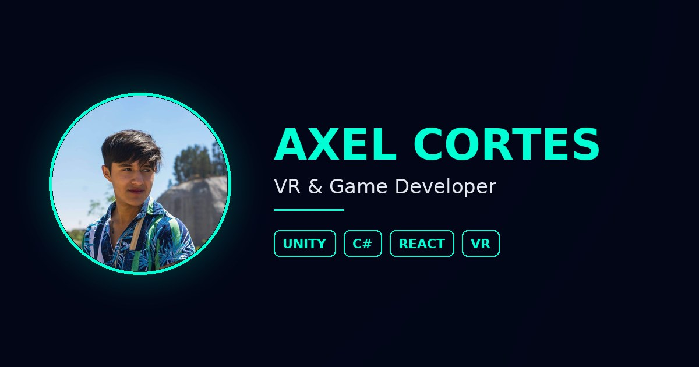

# Portafolio — Axel Cortes

Portafolio personal de **Axel Alejandro Cortes Fonseca**, desarrollador de videojuegos, realidad virtual y aplicaciones web.

🔗 **Demo:** https://axelcortesdev.vercel.app



---

## Qué incluye

- **Hero** con presentación y accesos directos a proyectos, CV y contacto.
- **Habilidades** separadas en Web, Unity/Game Dev y herramientas.
- **Formación académica** en línea de tiempo.
- **Proyectos** con pestañas (Videojuegos & VR / Web), preview en video al pasar el cursor y modal con detalles técnicos de cada proyecto.
- **Página de contacto** con formulario (Formspree), WhatsApp y correo.
- **Cotizador** de páginas web, juegos para celular y experiencias VR: paquetes, extras, plan anual (web), forma de pago e IVA; genera PDF (jsPDF) y mensaje de WhatsApp. Precios y textos en `src/data/precios.js`.

## Stack

| Área | Tecnologías |
|---|---|
| Base | React 19, Vite 7 |
| Rutas | React Router 7 |
| Animación | Framer Motion, tsParticles |
| Iconos | Boxicons, React Icons |
| Alertas | SweetAlert2 |
| Formulario | Formspree |
| Estilos | Tailwind CSS 4 + shadcn/ui, más un CSS por página |
| PDF | jsPDF (carga diferida) |

## Correr en local

```bash
npm install
npm run dev      # http://localhost:5173
```

Otros comandos:

```bash
npm run build    # build de producción en /dist
npm run preview  # sirve el build localmente
npm run lint     # ESLint
```

## Estructura

```
src/
├── assets/          # imágenes, videos y projectsData.js
├── components/      # Navbar, Hero, Footer, Card, ProjectModal, ParticlesBackground
├── data/info.js     # datos personales, redes y ruta del CV
├── data/precios.js  # categorías, paquetes, extras, planes y textos del cotizador
├── lib/             # utils (cn) y generador del PDF de cotización
├── pages/           # ContactPage, CotizadorPage, NotFound
├── sections/        # Skills, Education, Projects
└── styles/          # un CSS por componente + global.css
```

## Cómo agregar un proyecto

Edita `src/assets/projects/projectsData.js` y añade un objeto al arreglo:

```js
{
  id: 8,
  title: "Nombre del proyecto",
  category: "games",          // "games" | "web"
  description: "Una línea sobre qué es.",
  tags: ["Unity", "C#"],
  format: "vertical",         // "vertical" | "horizontal"
  image: miImagen,            // importada arriba
  videoPreview: miVideo,      // opcional
  type: "games",              // "games" | "vr" -> abre modal; "link" -> abre el sitio
  link: "https://...",        // opcional
  repo: "https://github.com/...", // opcional, muestra el botón "Código"
  details: { mechanics: "...", devLog: "..." }
}
```

## Pendientes

- [x] Subir `CV-Axel-Cortes.pdf` a `/public`
- [x] Publicar en GitHub los repos de *Lorely Fotos* y *Botanas Mony* y enlazarlos en `projectsData.js`
- [ ] Grabar los videos de las experiencias VR

## Contacto

[LinkedIn](https://www.linkedin.com/in/axel-alejandro-cortes-fonseca/) · [GitHub](https://github.com/AxelCortes162) · axelcortes.developer@gmail.com
